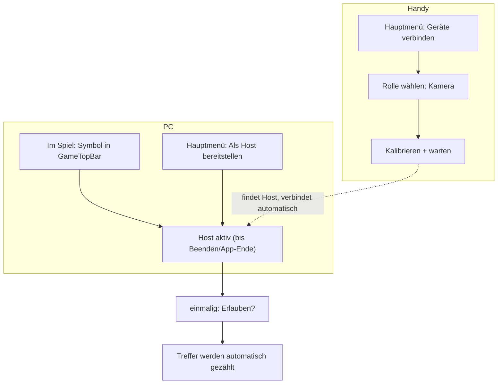
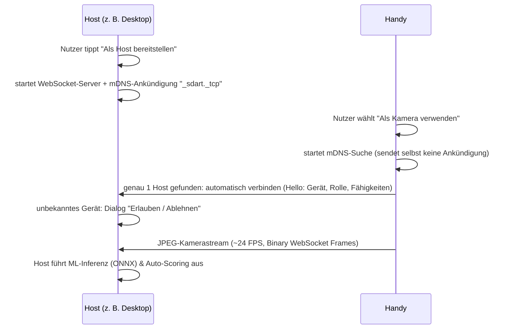

# s'Dart App – Companion-Verbindung (Host & Rollen)

> Status: **Konzept abgestimmt, noch nicht implementiert** (Stand 2026-10-09)

## 0. Einstiegspunkte in der App (Wann & Wo)

| Wo | Aktion | Zweck |
|---|---|---|
| **Hauptmenü → Kachel „Geräte verbinden“** (alle Plattformen) | „Dieses Gerät nutzen als …“ → Kamera / Anzeige / Eingabe | Handy wird *vor* dem Spiel am Board befestigt und kalibriert |
| **Hauptmenü → „Geräte verbinden“ → „Als Host bereitstellen“** | Host im Menü starten | Für Anzeige-Geräte (zeigen Setup/Spielerwahl) und Vorab-Einrichtung |
| **Im Spiel → Symbol in der `GameTopBar`** (Hauptweg) | Host starten, Geräteübersicht öffnen | Direkt dort, wo man die Kamera braucht |

* **Host-Lebensdauer:** Der Host bleibt aktiv, bis man ihn beendet oder die App schließt – **nicht** nur für ein Spiel. Die Kamera bleibt über Spielende, Zusammenfassung und Rematch verbunden. Menü und Spiel nutzen dieselbe Freigabe.
* **Reihenfolge egal:** Ein Teilnehmer sucht weiter, bis ein Host auftaucht, und verbindet sich dann automatisch.
* **Statussymbol in der `GameTopBar`:** aus / wartet / verbunden (mit Geräteanzahl); Tipp öffnet die Geräteübersicht.
* **Warte-Bildschirm auf dem Handy** nennt den nächsten Schritt: *„Starte am PC ein Spiel und tippe auf das Kamera-Symbol.“*
* Die Kachel heißt bewusst „Geräte verbinden“ statt „Mit PC verbinden“, da der Host auch ein Tablet/Handy sein kann.



## 1. Ziel
Geräte mit der s'Dart App sollen sich so einfach wie bei Apple-Produkten verbinden lassen:
**kein QR-Code, keine IP-Eingabe, kein Pairing-Ritual.** Ein Gerät stellt sich als **Host** bereit,
andere Geräte wählen eine **Rolle** (Kamera, Anzeige, Eingabe) und verbinden sich automatisch.

## 2. Getroffene Entscheidungen

| Thema | Entscheidung | Begründung |
|---|---|---|
| Kopplung | Kein QR-Code, automatische Erkennung per mDNS/DNS-SD | Maximale Einfachheit |
| Sichtbarkeit | **Nur der Host** kündigt sich im Netz an – und nur nachdem der Nutzer „Als Host bereitstellen“ aktiviert hat | Datenschutz (z. B. im Vereinsheim), kein unnötiger Netzwerkverkehr |
| Teilnehmer | Suchen **nur** nach Hosts, nachdem eine Rolle gewählt wurde; sie kündigen sich selbst nie an | Unsichtbar, solange nicht aktiv genutzt |
| Rollenwahl | **Am Gerät selbst** (Kamera / Anzeige / Eingabe) | Das Kamera-Handy hat man beim Montieren ohnehin in der Hand |
| Sicherheit | Einmalige Abfrage am Host: *„Gerät X möchte sich als Kamera verbinden – Erlauben / Ablehnen“*, danach wird das Gerät wiedererkannt | Schutz vor fremden Geräten im selben WLAN, ohne Komfortverlust |
| Wiederverbinden | **Variante a:** Rolle bzw. Host-Modus wird bei jedem App-Start **neu gewählt** (ein Tipp). Kein Auto-Start. | Volle Kontrolle, nichts passiert ohne bewusste Aktion |
| Datenhoheit | Der Host hält Spielstand und Spielerdaten; Teilnehmer sind Sensoren/Ansichten | Kein widersprüchlicher Spielstand möglich |

## 3. Rollen

| Rolle | Aufgabe | Benötigte Fähigkeit | Datenfluss |
|---|---|---|---|
| **Host** | Spielsteuerung, Spielstand, Spielerdaten, ML-Inferenz bei Companion-Streams | – (jedes Gerät; Desktop nutzt ONNX, Handy NCNN) | Server |
| **Kamera** | Im Companion-Stream-Modus: Kamera-Capture + JPEG-Stream an Host (schont Akku/Hitze). Im Standalone-Modus: lokale NCNN-Erkennung. | Kamera (+ optional lokales NCNN im Standalone-Betrieb) | Teilnehmer → Host |
| **Anzeige** | Großes Live-Scoreboard (z. B. Tablet an der Wand) | Display | Host → Teilnehmer |
| **Eingabe** | Manuelle Punkte-Eingabe, Undo, Korrekturen | Touch | Teilnehmer → Host |

> **Architektur-Trennung Standalone vs. Host-Betrieb:**
> * **Standalone-Betrieb (Handy oder PC alleine):** Jedes Gerät nutzt seine eigene lokale Inferenz-Engine (Android: NCNN Vulkan, Desktop: ONNX Runtime).
> * **Host/Companion-Betrieb (Handy als Kamera gekoppelt mit Host):** Das Kamera-Smartphone **streamt nur die Frames** (JPEG über WebSocket, ~24 FPS). Die ML-Inferenz, Erkennung und automatische Punkteverbuchung wird **vollständig vom Host übernommen**. Das verhindert Überhitzung und Akku-Drain auf dem Smartphone während langen Dart-Sessions.

## 4. Ablauf



- **Mehrere Hosts gefunden:** kurze Auswahlliste („Desktop Marc“, „Laptop Verein“).
- **Host-Übersicht:** Liste aller verbundenen Geräte mit Rolle, Verbindungsqualität, „Trennen“.
- **Zentrale Kamera-Quellenauswahl (Dropdown):** Direkt im Host-Fenster (`HostOverviewDialog`) als einheitliches Dropdown-Menü integriert. Enthält alle verfügbaren lokalen USB-Webcams/Gerätekameras sowie alle über den Host per WLAN verbundenen Begleit-Kameras (Live-Status und automatische Host-Aktivierung).
- **Gemerkte Geräte:** Werden nicht mehr als Inline-Dropdown, sondern auf einer eigenen Unterseite innerhalb des Popups verwaltet (inklusive Einzelaustragung und „Alle entfernen“).
- **Freigabe aus = Netzwerk aus:** Beenden der Freigabe oder der App stoppt Server und Ankündigung vollständig. Im inaktiven Zustand zeigt das Hostfenster ein aufgeräumtes Design ohne Hilfstexte.

## 5. Technische Bausteine

| Baustein | Umsetzung |
|---|---|
| Erkennung Android | `NsdManager` (registerService / discoverServices) |
| Erkennung iOS | Bonjour (`NWBrowser` / `NWListener`), `Info.plist`: `NSLocalNetworkUsageDescription`, `NSBonjourServices = _sdart._tcp` |
| Erkennung Desktop | `JmDNS` |
| Service-TXT-Record | `name`, `platform`, `protocolVersion`, `hostId` |
| Transport | **Eine** WebSocket-Verbindung pro Teilnehmer (Ktor Server auf dem Host, Ktor Client auf Teilnehmern; Protokoll in `commonMain`) |
| Nachrichten | JSON (`kotlinx.serialization`) für Steuerung/Events, Binär-Frames für JPEG-Vorschau |
| Gerätevertrauen | Jedes Gerät erzeugt einmalig eine `deviceId` (UUID). Der Host speichert erlaubte `deviceId`s in einer Trust-Liste (in den Einstellungen widerrufbar) |

### Nachrichtentypen (Entwurf)
```text
Hello(deviceId, deviceName, platform, role, capabilities, protocolVersion)
Welcome(sessionId, hostName) | Rejected(reason)
DartHit(segment, multiplier, dartIndex, confidence, x, y)
BoardCleared
PreviewFrame(binary JPEG)
ScoreInput(points / segment) | Undo
GameStateUpdate(snapshot)          // Host → Anzeige/Eingabe
Ping / Pong                        // Verbindungsüberwachung
Bye
```

### Code-Struktur (geplant)
```text
commonMain/.../connect/
├── DeviceRole.kt            # Host, Camera, Display, Input
├── ConnectMessages.kt       # Protokoll (serialisierbar)
├── SessionManager.kt        # Host-Seite: Teilnehmer, Trust-Liste, Routing zum DartViewModel
├── ParticipantClient.kt     # Teilnehmer-Seite: Verbinden, Senden, Reconnect
└── ServiceDiscovery.kt      # expect: advertise()/stopAdvertise(), browse()/stopBrowse()
androidMain / iosMain / desktopMain/.../connect/
└── ServiceDiscovery.<platform>.kt   # actual: NsdManager / Bonjour / JmDNS
```
Netzwerk-I/O läuft ausschließlich in Coroutines (`Dispatchers.IO`), nie im UI-Thread.
Die Discovery ist hinter einem Interface gekapselt, damit UI und `SessionManager` mit einem Fake testbar sind.

## 6. Bekannte Hürden

> [!WARNING]
> **Windows-Firewall:** Ein Java-Server löst beim ersten Start einen Firewall-Dialog aus; mDNS (UDP 5353) wird teils blockiert.
> Lösung: Firewall-Regel im MSI-Installer anlegen (`packageMsi`/WiX) und im Host-Screen einen Hinweis anzeigen, falls nach X Sekunden kein Gerät gefunden wird.

- **Router mit Client-Isolation** (Gast-WLAN, „AP Isolation“): mDNS funktioniert dort nicht. Notlösung: versteckte **manuelle IP-Eingabe** in den Einstellungen (Entwickler/Erweitert).
- **iOS Local-Network-Abfrage:** einmalige Systemabfrage – erscheint dank Opt-in erst beim ersten Aktivieren einer Rolle.
- **Android Hintergrund:** Kamera-Rolle nur im Vordergrund (Bildschirm an); ggf. Foreground-Service + Wake-Lock.

## 7. Spielerdaten
Solange nur der Host spielt, greifen Teilnehmer über die Verbindung auf die Host-Daten zu – kein Sync nötig.
Sobald auf mehreren Geräten **unabhängig** gespielt und später zusammengeführt werden soll, muss das Datenmodell umgestellt werden:
- `playerId` (UUID) statt Name als Schlüssel,
- jedes Spiel als unveränderlicher Eintrag mit `gameId` (UUID),
- Statistiken werden **berechnet** statt aufsummiert (aktuell: Zähler in `SavedPlayer`, nicht mergebar),
- Merge = Vereinigung über `gameId`, Migration von `saved_players_v2.json` mit vorherigem Backup.

## 8. Umsetzungsschritte
1. [X] **Protokoll & Rollen** in `commonMain` (`DeviceRole.kt`, `ConnectMessages.kt`, kotlinx.serialization) + Unit-Tests (`ConnectProtocolTest`, `desktopTest` grün; Android kompiliert).
2. [X] **ServiceDiscovery** (`ServiceDiscovery.kt` mit `HostRegistry` + `FakeServiceDiscovery`; Desktop: JmDNS, Android: NsdManager, iOS: Platzhalter). Unit-Tests grün, Desktop + Android kompilieren. *Noch nicht im echten Netz getestet (Desktop ↔ Handy) – folgt, sobald der Host-Server steht.*
3. [X] **Host:** WebSocket-Server (Java-WebSocket auf Desktop & Android JVM), `SessionManager.kt`, Trust-Liste (persitiert), globaler „Erlauben“-Dialog (`HostAuthorizationDialog`), Host-Übersicht (`HostOverviewDialog`) in `GameScreen` & `StartScreen`. 15 Tests grün, Android & Desktop kompilieren.
4. [X] **Teilnehmer:** Rollenauswahl-Screen (`CompanionConnectionScreen.kt`), automatische Host-Suche mit Zero-Touch Auto-Connect bei 1 Host, `ParticipantSessionManager.kt`, WebSocket-Client (Desktop & Android). 21 Tests grün, Android & Desktop kompilieren.
5. [X] **Rolle Kamera:** Vollständig bidirektionales JPEG-Streaming zwischen Handy und PC (`CameraVideoFeed.desktop.kt` / `android.kt`). Beide Richtungen unterstützt: Handy als Kamera $\rightarrow$ PC als Host (mit ONNX-Inferenz) und PC als Kamera (USB-Webcam) $\rightarrow$ Handy als Host (mit NCNN-Inferenz). UI beim Streamen entspricht exakt dem Original-Design (`StreamingView` aus `PcIntegrationScreen`): Reines Vollbild-Kamerabild, automatischer Stromspar-/Abdunklungsmodus nach 10 Sekunden Inaktivität (schwarzer Bildschirm, `ic_camera_placeholder`, „Energiesparend...“, Tap-to-Wake), Beenden-Button sowie **echte Hardware-Bildschirmhelligkeitsdrosselung** (`PlatformScreenBrightness` regelt die Display-Hintergrundbeleuchtung auf Minimalstufe 0.01f runter und hält das Gerät ohne Standby-Timeout wach; bei Tap-to-Wake oder Verlassen wird die normale Systemhelligkeit sofort wiederhergestellt).
6. [X] **Rolle Eingabe:** Vollständig ausgereifte, echtzeit-synchronisierte Eingabe über `GameSnapshot`. Das Companion-Gerät empfängt live Spielername, Restpunkte, Checkout-Vorschlag, Darts der aktuellen Runde, Bust- und Sieger-Status. Das interaktive Touch-Dartboard (`InteractiveDartboard` + Lupe) zeichnet die echten Trefferkoordinaten, hebt relevante Segmente hervor und sendet `ScoreInput` & `Undo`. Automatische Runden- und Spielerwechsel nach 3 Würfen wie im regulären Spiel, dedizierter „Fehlwurf (0)“-Button für Bouncer/Abpraller und optionales vorzeitiges Beenden einer Runde. Inaktive Spiele zeigen einen sauberen Warte-Screen.
7. [X] **Rolle Anzeige:** `CompanionScoreboardView` empfängt `GameSnapshot` via `GameStateUpdate` und rendert ein responsives Vollbild-Scoreboard (Split-Screen im Querformat / adaptive Liste im Hochformat) mit gigantischer Punktanzeige des aktiven Spielers, Checkout-Empfehlung, den 3 Darts der aktuellen Aufnahme, Cricket-Marken / ATC-Zielen und vollständiger Spielertabelle aller Teilnehmer. Inaktive Spiele zeigen einen sauberen Warte-Screen.
8. [ ] **Installer:** Firewall-Regel im MSI; manuelle IP als Notlösung.
9. [ ] **iOS:** Bonjour-Implementierung + `Info.plist`-Einträge.
10. [ ] *(später)* Datenmodell-Umbau für geräteübergreifenden Sync.
